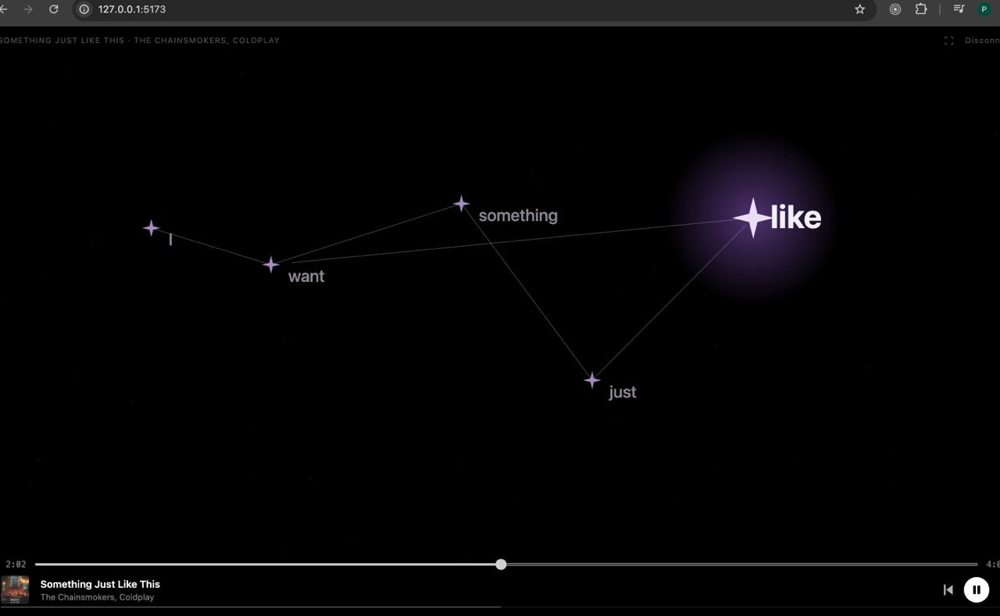

# Lyricscape

A fullscreen web visualizer that turns synced Spotify lyrics into animated star constellations. Each word becomes a star; lines connect them into a constellation that shifts with every new lyric line. A purple glowing arc travels around the screen edge as the music plays.



## Features

- **Lyric constellations** — each word in the current lyric line is plotted as a star on a canvas; lines connect them to form a constellation shape
- **Synced lyrics** — fetched from [LRCLib](https://lrclib.net/) and timed to the playback position
- **Spotify Web Playback SDK** — registers the browser as a "Lyric Constellations" playback device; full player controls (play/pause, skip, seek) built in
- **Animated border glow** — a moving purple arc traces the screen edge using Canvas
- **Fullscreen mode** — one-click fullscreen with Escape to exit
- **Seek bar** — smooth seek bar driven by SDK position events, not polling

## Stack

| Layer | Tech |
|-------|------|
| Client | React 19 + Vite + TypeScript + Tailwind CSS |
| Server | Node.js + Express + TypeScript |
| Auth | Spotify OAuth 2.0 PKCE (token exchange server-side) |
| Lyrics | LRCLib public API |
| Playback | Spotify Web Playback SDK |

## Prerequisites

- Node.js 18+
- A [Spotify Developer](https://developer.spotify.com/dashboard) app with a **Premium** account
- The redirect URI `http://127.0.0.1:3001/auth/callback` added to your Spotify app's allowed redirect URIs

> **Note:** The Spotify Web Playback SDK requires a Premium account. Free accounts will connect but cannot play audio through the browser device.

## Setup

### 1. Clone and install

```bash
git clone <repo-url>
cd lyricscape

# install server deps
cd server && npm install

# install client deps
cd ../client && npm install
```

### 2. Configure the server

```bash
cd server
cp .env.example .env
```

Edit `.env`:

```env
SPOTIFY_CLIENT_ID=your_client_id
SPOTIFY_CLIENT_SECRET=your_client_secret
SPOTIFY_REDIRECT_URI=http://127.0.0.1:3001/auth/callback
CLIENT_URL=http://localhost:5173
COOKIE_SECRET=any_random_string
PORT=3001
```

### 3. Run

Open two terminals:

```bash
# terminal 1 — server
cd server && npm run dev
```

```bash
# terminal 2 — client
cd client && npm run dev
```

Then open [http://localhost:5173](http://localhost:5173).

## How it works

1. **Auth** — the server handles the Spotify PKCE flow and stores tokens in `httpOnly` cookies (`sp_access`, `sp_refresh`, `sp_expires`)
2. **SDK** — on sign-in the client loads the Spotify Web Playback SDK and registers a "Lyric Constellations" device; `player_state_changed` events provide real-time track metadata and position
3. **Lyrics** — when the track changes, the client fetches synced LRC lyrics from `/api/lyrics`, which proxies LRCLib
4. **Constellation** — a Canvas RAF loop maps each word in the active lyric line to a random star position, animates transitions between lines, and draws connecting lines
5. **Border glow** — a second Canvas overlay draws a moving arc around the viewport perimeter using layered strokes with `shadowBlur` for the neon look

## Project structure

```
lyricscape/
├── client/
│   └── src/
│       ├── components/
│       │   ├── BorderGlow.tsx   # animated perimeter glow canvas
│       │   ├── Constellation.tsx # star/lyric canvas
│       │   ├── LoginScreen.tsx
│       │   └── Player.tsx       # seek bar + controls
│       ├── hooks/
│       │   ├── useNowPlaying.ts  # polling fallback
│       │   └── useSpotifyPlayer.ts # Web Playback SDK
│       ├── lib/
│       │   └── lrc.ts           # LRC timestamp parser
│       └── App.tsx
└── server/
    └── src/
        ├── middleware/auth.ts   # cookie token validation
        ├── lib/spotify.ts       # OAuth helpers + scopes
        └── routes/
            ├── auth.ts          # /auth/login, /callback, /logout
            └── spotify.ts       # /api/spotify/now-playing, /token
```

## Scopes requested

`user-read-currently-playing` `user-read-playback-state` `user-modify-playback-state` `streaming` `user-read-email` `user-read-private`

## Known limitations

- Spotify developer apps in development mode only allow up to 25 users listed in the [User Management](https://developer.spotify.com/dashboard) dashboard
- The browser SDK device appears as "Lyric Constellations" in the Spotify app — you must transfer playback to it manually or use the in-app player controls
- LRCLib may not have synced lyrics for every track; the app shows an unsynced fallback message in that case
